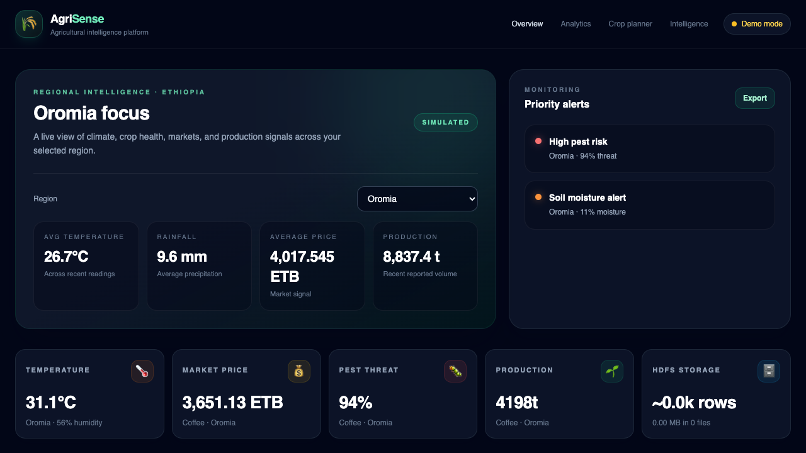

# AgriSense

### Big Data Agricultural Intelligence and Decision Support for Ethiopia

AgriSense is a real-time agricultural data platform that brings together weather, crop-health, market, and production signals. It demonstrates how a streaming and batch big-data pipeline can power a practical farmer-facing crop planning tool and an operations dashboard.

> **Project author:** Zenebu Melaku · **ID:** CTC-3812-26 · **Stream:** Emerging Technology · **Institution:** INSA



## Project at a glance

| Area | Technology and purpose |
|---|---|
| Web dashboard | React, Vite, Tailwind CSS, Recharts |
| API | FastAPI endpoints for service health, pipeline overview, streaming, and crop advice |
| Streaming | Apache Kafka topics for weather, market, crop-risk, and production events |
| Batch storage | Hadoop HDFS stores event batches as JSON Lines files |
| Analytics | Python regional summaries, risk heuristics, yield proxy, and crop suitability ranking |
| Data sources | Open-Meteo weather; NASA POWER agro-climate data; baseline ETB market prices |
| UI verification | Playwright end-to-end browser tests |

## What it does

- Streams agricultural events through Kafka across four topics: `agri.weather`, `agri.market`, `agri.crop`, and `agri.production`.
- Batches consumed events into JSONL files in HDFS for durable historical storage and downstream analytics.
- Displays live or demo-mode weather, market, crop-risk, and production signals, with regional filters and operational indicators.
- Highlights priority conditions such as high pest pressure, low soil moisture, and market-price spikes.
- Ranks teff, maize, wheat, sorghum, and coffee for a farmer's broad region, season, soil, water, and farm-size context.
- Explains each crop's score, limitations, and missing information; saves recent assessments in the browser for comparison.
- Exports a dashboard status and analytics report as JSON.

## Big-data architecture

```text
Open-Meteo / NASA POWER / baseline market data
                       |
                       v
           Python agricultural producer
                       |
             Kafka event topics
                       |
          +------------+-------------+
          |                          |
          v                          v
  FastAPI Server-Sent Events     HDFS batch consumer
          |                          |
          v                          v
  React live dashboard      JSONL historical batches
                                     |
                                     v
                           Python analytics endpoints
```

Kafka separates event producers from consumers and organizes event streams by data domain. The HDFS consumer buffers these events and writes batches as JSON Lines, a simple format suited to append-oriented ingestion and later analysis. The FastAPI layer exposes service health and pipeline metadata, forwards Kafka events to the browser over Server-Sent Events, and serves analysis endpoints. The dashboard combines the live feed with HDFS-backed insights and farmer-input recommendations.

## Machine-learning and analytics approach

AgriSense demonstrates the data-to-decision flow while making the current model's limits explicit:

1. **Input signals:** regional temperature, rainfall, soil moisture, pest-threat index, vegetation-health index, market price, and reported production.
2. **Regional risk summary:** combines pest pressure, low soil moisture, rainfall deficit, market-price pressure, and vegetation-health signals into a bounded risk score. Thresholds map the score to a readable alert and agronomic action.
3. **Yield indicator:** combines the available health and climate signals with historical/reporting production to calculate an indicative yield proxy. It is not a supervised forecast trained against measured yield outcomes.
4. **Personalized crop suitability:** scores five Ethiopian crops using broad crop-season fit (35%), soil fit (35%), and water fit (30%). A score is a relative rule-based suitability indicator, not a probability of success or yield.
5. **Explainability:** recommendation reasons, limitations, and missing information are returned with the score instead of presenting an unexplained number.

These are transparent, deterministic analytics and heuristics—not a locally validated or fitted machine-learning model. The project does not yet have labelled multi-year farm-level yield data, soil tests, local crop trial data, or validated climate/market history to train and evaluate a credible predictive model. Region and farm size are captured by the crop planner but are not included in its suitability score because the project currently lacks validated regional response and farm-economics data. Treat outputs as planning demonstrations and consult local agronomists before making planting or investment decisions.

### Data provenance

- **Weather:** Open-Meteo current conditions for approximate regional coordinates.
- **Agro-climate:** NASA POWER daily data used to derive crop-signal indicators.
- **Market:** baseline ETB price values with small generated variation; these are not a live market-price feed.
- **Demo mode:** the browser generates visibly labelled mock events when the live event stream is unavailable.

Confirm source timestamps, coverage, and licensing before using the data for research conclusions or operational decisions.

## Repository layout

```text
.
├── README.md
├── docs/images/                 # Project screenshots
├── frontend/
│   ├── src/components/           # Charts, event feed, and crop planner
│   ├── src/hooks/                # Live-event connection and demo stream
│   ├── e2e/                      # Playwright browser journeys
│   └── playwright.config.js
└── agri_intelligence/
    ├── analytics/                # HDFS reader, insights, and crop advisor
    ├── config/                   # Kafka and HDFS configuration
    ├── data_ingestion/           # Agricultural event producer and sources
    ├── hdfs_storage/             # Kafka-to-HDFS batch consumer
    └── pipeline_api/             # FastAPI, Kafka, and HDFS adapters
```

## Getting started

### Requirements

- Node.js and npm
- Python 3.10 or later
- For a fully live pipeline: Apache Kafka and Hadoop HDFS configured and running
- Google Chrome for the included Playwright browser tests

The dashboard and crop recommendation feature can be explored in demo mode without Kafka or HDFS. For historical HDFS analysis and a fully live stream, start the relevant infrastructure.

### 1. Start the API

From the repository root:

```bash
cd agri_intelligence
python3 -m venv .venv
source .venv/bin/activate
python -m pip install fastapi uvicorn kafka-python pandas
python -m uvicorn pipeline_api.main:app --reload --port 8001
```

The API documentation is available at `http://localhost:8001/docs`. The dashboard's crop-advisor endpoint works independently of Kafka and HDFS; live streaming and stored historical analytics require their respective services.

### 2. Start the dashboard

In another terminal, from the repository root:

```bash
cd frontend
npm ci
npm run dev -- --port 5173
```

Open `http://localhost:5173`.

### 3. Start the full data pipeline (optional)

Start Kafka and HDFS using your local installation, then from `agri_intelligence/` with the Python environment active:

```bash
python -m data_ingestion.producer
```

In another terminal:

```bash
cd agri_intelligence
source .venv/bin/activate
python -m hdfs_storage.hdfs_batch_consumer
```

The producer calls external weather/agro-climate sources and publishes events to Kafka. The consumer batches Kafka records into HDFS. These services require valid local Kafka/HDFS configuration and network access to external data sources.

## API

| Method | Endpoint | Description |
|---|---|---|
| `GET` | `/api/health` | Kafka and HDFS reachability |
| `GET` | `/api/pipeline/overview` | Topic names and HDFS storage summary |
| `GET` | `/api/pipeline/summary` | Combined pipeline and regional insight summary |
| `GET` | `/api/ml/insights` | HDFS-backed regional risk and yield-proxy analytics |
| `GET` | `/api/recommendations` | Regional operational actions |
| `POST` | `/api/ml/crop-recommendations` | Personalized crop suitability ranking |
| `GET` | `/api/events/stream` | Kafka event stream over Server-Sent Events |

Example crop recommendation request:

```bash
curl -X POST http://localhost:8001/api/ml/crop-recommendations \
  -H 'Content-Type: application/json' \
  -d '{
    "region": "Amhara",
    "season": "Meher",
    "soil_type": "loamy",
    "water_availability": "moderate",
    "farm_size_ha": 2.5
  }'
```

## Verification

Build the production frontend:

```bash
cd frontend
npm ci
npm run build
```

Run the browser end-to-end suite (the Playwright configuration uses installed Google Chrome):

```bash
npm run test:e2e
```

The suite starts the FastAPI app and Vite development server and checks dashboard rendering/region selection, ranked crop advice and its caveats, backend rejection of invalid regions, and saved-assessment comparison. The dashboard journey also refreshes [`docs/images/agrisense-dashboard.png`](docs/images/agrisense-dashboard.png).

## Future work

- Collect and curate labelled, multi-season farm data; document provenance and consent.
- Train and cross-validate crop-specific yield/risk models with temporal and regional holdouts.
- Add baseline comparisons, MAE/RMSE or classification metrics, calibration, and model-version tracking.
- Include soil tests, elevation, planting date, crop variety, and local agronomist-reviewed rules.
- Replace demonstration market prices with a verified, regularly updated market feed.
- Add Kafka/HDFS deployment automation, schema validation, observability, and data-quality monitoring.

---

**Prepared for project submission** · Zenebu Melaku · CTC-3812-26 · Emerging Technology Stream, INSA
